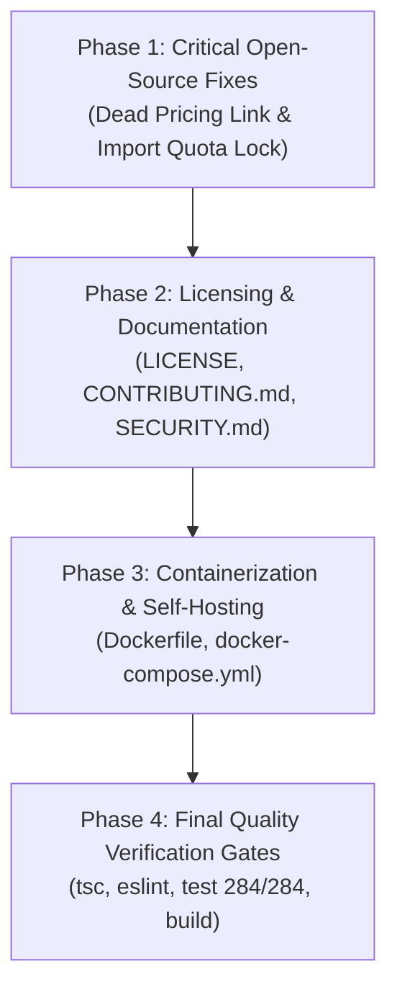

# Keeper Open-Source Edition — Prioritized Implementation Plan

> **Plan Type:** Technical Remediation & Open-Source Release Strategy  
> **Target:** Keeper Open-Source Edition (`open_source_keeper`)  
> **Lead Architect:** Senior Full-Stack Engineer & Open-Source Maintainer  
> **Date:** November 1, 2026  

---

## 1. Plan Overview & Objectives

This implementation plan outlines the prioritized engineering steps required to transition Keeper Open-Source Edition from its current audited state into a polished, production-ready, community-facing open-source release.

### Core Objectives:
1. **Eliminate All Commercial Remnants**: Resolve dead pricing links and remove artificial import quota roadblocks.
2. **Establish Open-Source Standards**: Add official open-source licensing (`LICENSE`), contribution guidelines (`CONTRIBUTING.md`), and security reporting procedures (`SECURITY.md`).
3. **Enable 1-Click Containerized Self-Hosting**: Provide a multi-stage production `Dockerfile` and `docker-compose.yml` supporting standalone PostgreSQL and MongoDB modes.
4. **Enforce Non-Regression Quality Gates**: Guarantee that all 284 tests pass, TypeScript compiles with 0 errors, ESLint meets quality thresholds, and Next.js Turbopack build succeeds.

---

## 2. Prioritized Implementation Roadmap



---

## 3. Phase Breakdown & Action Items

### Phase 1: Critical Open-Source Remnants & Polish (P0 — Immediate)

#### Task 1.1: Remove Dead `#pricing` Navigation Link
- **Target File:** `src/components/landing/KrackerzNav.tsx`
- **Current Issue:** Lines 65 and 95 define `pricing` in `sections` and `navLinks` with anchor `href: "#pricing"`. Clicking this navigates nowhere because no pricing section exists.
- **Action:** Replace the pricing entry with an "OPEN SOURCE" community link or clean feature link:
  ```typescript
  const navLinks = [
    { label: "FEATURES", id: "features", href: "#features" },
    { label: "PARTNERS", id: "partners", href: "#partners" },
    { label: "STICKER LAB", id: "stickers", href: "#stickers" },
    { label: "FAQ", id: "faq", href: "#faq" },
  ];
  ```
- **Verification:** Confirm landing page navigation links scroll to valid sections without dead anchors.

#### Task 1.2: Remove Artificial Import Quota Roadblock in Bulk Import
- **Target File:** `src/components/bulk-import/PreImportAnalysisModal.tsx`
- **Current Issue:** Lines 64–70 and 363–369 disable bulk import and show *"Remaining import quota is 0. Imports cannot proceed until limits are reset or upgraded"* if `remainingLimit <= 0`.
- **Action:** 
  - In Open-Source Edition, imports are 100% unlimited.
  - Update quota display banner to show an "Unlimited Open-Source Imports" badge.
  - Remove `isQuotaExhausted` blocking logic from `handleStart` and the "Start Import" button.
  - Ensure the button always allows proceeding when ready items exist.
- **Verification:** Validate that a batch of 50+ items can be imported without artificial limit blocks.

---

### Phase 2: Open-Source Governance & Community Readiness (P1)

#### Task 2.1: Add Open-Source License File
- **Target File:** `LICENSE` (Root)
- **Action:** Add the standard **Apache License 2.0** or **MIT License** granting community users full freedom to use, modify, distribute, and self-host Keeper.

#### Task 2.2: Add Community Guidelines
- **Target Files:** `CONTRIBUTING.md` and `SECURITY.md`
- **Action:**
  - `CONTRIBUTING.md`: Document local development setup (`npm run dev`), test execution (`npm test`), PR workflows, and coding conventions.
  - `SECURITY.md`: Outline vulnerability disclosure policy, contact information, and security practices.

#### Task 2.3: Polish Documentation
- **Target File:** `README.md`
- **Action:** Ensure clear badges, architecture diagrams, Docker self-hosting instructions, and environment variable setup guides.

---

### Phase 3: Containerization & Self-Hosting Infrastructure (P1)

#### Task 3.1: Production Multi-Stage Dockerfile
- **Target File:** `Dockerfile` (Root)
- **Action:** Create an optimized multi-stage build:
  - Stage 1 (`deps`): Install dependencies via `npm ci`.
  - Stage 2 (`builder`): Build Next.js application via `npm run build`.
  - Stage 3 (`runner`): Lightweight Node 22 Alpine runtime with non-root user (`nextjs:nodejs`), exposing port 3000.

#### Task 3.2: Standalone Docker Compose Setup
- **Target File:** `docker-compose.yml` (Root)
- **Action:** Provide multi-service composition:
  - `keeper-app`: Next.js web application.
  - `keeper-postgres`: PostgreSQL 17 container with automated schema seeding from `database/postgres/001_keeper.sql`.
  - Optional `keeper-mongodb`: Single-node MongoDB 8 replica set.

---

### Phase 4: Final Quality Verification Gates (P0 — Mandatory)

Execute all four operational validation gates:

| Step | Command | Acceptance Criteria |
| :---: | :--- | :--- |
| **Gate 1** | `npm run type-check` | TypeScript compiler exits with **0 errors**. |
| **Gate 2** | `npm run lint` | ESLint exits with **0 errors** (warnings below ceiling). |
| **Gate 3** | `npm test` | All **284 automated tests pass** across 25 suites. |
| **Gate 4** | `npm run audit:design` | 60:30:10 palette audit passes **100%**. |
| **Gate 5** | `npm run build` | Turbopack compiles all 28 static & dynamic routes cleanly. |

---

## 4. Risk Assessment & Invariant Safety

| Risk | Impact | Mitigation Strategy |
| :--- | :---: | :--- |
| Accidental modification of `main` branch | Critical | Strict Git policy: work strictly on `open_source_keeper`. Never checkout or push to `main`. |
| Regression of 284 passing tests | High | Run full regression suite after any code modification. |
| Overwriting authoritative export data | High | Enforce `ContentService.safeMerge` immutability invariant. |
| Secret leakage in documentation | High | Review `.env.example` and documentation templates for placeholder values only. |

