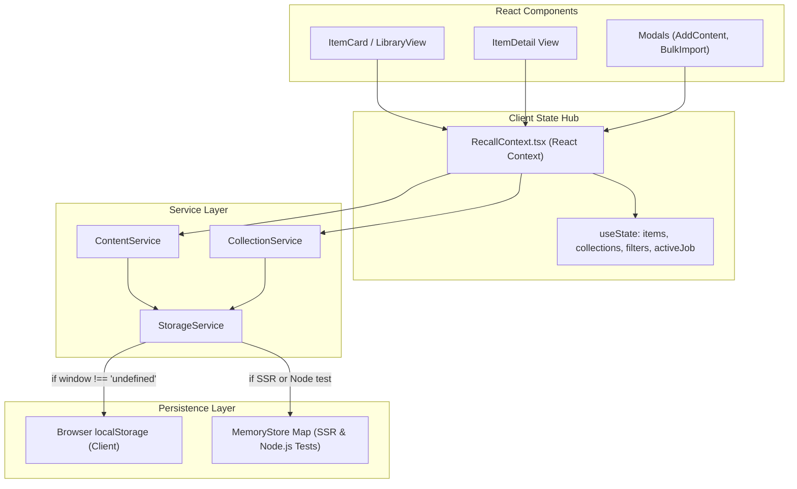

# Keeper — Storage & State Management

*Last updated: 2026-10-21 10:44 IST*

This document explains where data lives in Keeper, how client state syncs with persistence, and how tenant isolation is guaranteed.

---

## State & Storage Architecture

---

## The Storage Layer (`StorageService`)

Located in [`src/services/storage-service.ts`](file:///Volumes/T7/Devang/Code/Real_Project/Keeper/src/services/storage-service.ts):

### 1. Dual-Mode Storage Adapter
- **Browser Environment**: Direct access to `window.localStorage`.
- **Server-Side Rendering / Node.js Test Harness**: High-performance in-memory `Map<string, string>` fallback (`memoryStore`).
- **Why it matters**: Allows all services and test runners to execute without `window` mocks while preventing tests from mutating real developer data.

### 2. Multi-Tenant Key Isolation
All storage keys are namespaced by `userId`:
- Items Key: `recall_items_user_${userId}` (default: `recall_items_user_anonymous`)
- Collections Key: `recall_collections_user_${userId}` (default: `recall_collections_user_anonymous`)
- Active Job Key: `recall_active_job_user_${userId}`
- User Session Key: `recall_auth_session`

When a new user context is initialized, default system collections (`INITIAL_COLLECTIONS` from [`src/data/seed-data.ts`](file:///Volumes/T7/Devang/Code/Real_Project/Keeper/src/data/seed-data.ts)) are provisioned into the user's isolated store.

---

## Server Source of Truth & Cross-Device Synchronization

Keeper treats the authenticated user's server-side account in Supabase as the single source of truth:
- **`keeper_media` Table**: Scoped strictly to `workspace_id = auth.uid()`. Stores canonical URL, platform, collection assignments, tags, favorites, archive/trash status, and JSONB payload.
- **`keeper_collections` Table**: Scoped to `workspace_id = auth.uid()`. Stores collection definitions and metadata.
- **`keeper_media_analyses` Table**: Stores AI transcripts, summaries, topics, and analysis status linked via `media_id`.

### Synchronization Flow & Endpoints:
1. **Initial Mount & Sign-in**: `RecallContext` loads local cache immediately for zero-layout shift, and asynchronously triggers `syncWorkspace(userId)`:
   - Fetches authoritative collections from `GET /api/collections/sync` (auto-seeds defaults if 0 exist).
   - Runs `MigrationService.migrateLegacyData(userId)` to discover unnamespaced or anonymous local items.
   - Performs bidirectional synchronization with `POST /api/media/sync`, reconciling local saves with server items using `ContentService.safeMerge`.
2. **Real-time Lifecycle Sync**:
   - Reconnect: Listens to browser `online` events to immediately flush offline changes.
   - Multi-device focus: Debounced `window.focus` sync re-checks server source of truth when a user returns to a tab on desktop or mobile.
3. **Item & Collection Mutations**:
   - Optimistically updates React state and local storage cache.
   - Concurrently updates the database via server routes:
     - `POST /api/media`: Single/batch item upsert.
     - `PATCH /api/media/[id]`: Partial item update (favorites, notes, archive, collections).
     - `DELETE /api/media`: Item deletion or bulk trash purge.
     - `POST /api/collections/sync`: Collection creation / batch updates.
     - `DELETE /api/collections/sync`: Collection deletion with database cascade.
     - `DELETE /api/collections/[id]/items`: Collection item removal / unlinking.

---

## Centralized React Context (`RecallContext`)

Located in [`src/context/RecallContext.tsx`](file:///Volumes/T7/Devang/Code/Real_Project/Keeper/src/context/RecallContext.tsx):

### Managed State:
- `items: SavedItem[]`: Full library of items for the active user.
- `collections: Collection[]`: Active user collections.
- `syncStatus: "synced" | "syncing" | "offline" | "error"`: Current server synchronization state.
- `lastSyncTime: number | null`: Epoch timestamp of last successful server sync.
- `selectedCollectionId: string | null`: Active collection filter.
- `searchQuery: string`: Active search input.
- `selectedPlatform: Platform | "all"`: Platform filter.
- `selectedContentType: ContentType | "all"`: Content type filter.
- `viewMode: ViewMode`: `"grid"` | `"list"` | `"compact"`.
- `toasts: ToastMessage[]`: Active toast notification queue.
- `activeJob: ImportJob | null`: Currently executing or paused bulk import job.

### Primary Mutation Handlers:
- `addItem(item)`: Adds item locally and persists to `POST /api/media`.
- `updateItem(id, updates)`: Routes updates through `ContentService.safeMerge` and syncs to `PATCH /api/media/[id]`.
- `toggleFavorite(id)`: Toggles favorite status locally and on server.
- `archiveItem(id) / unarchiveItem(id)`: Updates archive state locally and on server.
- `trashItem(id) / restoreItem(id)`: Soft-deletes / restores item locally and on server.
- `permanentDeleteItem(id)`: Deletes item from local storage and sends `DELETE` to `/api/media/[id]`.
- `emptyTrash()`: Permanently deletes all items marked `trashed = true` locally and sends `DELETE /api/media?trashed=true`.
- `createCollection(name, ...)`: Optimistic creation + `POST /api/collections/sync`.
- `updateCollection(id, updates)`: Optimistic update + `POST /api/collections/sync`.
- `deleteCollection(id)`: Optimistic deletion + `DELETE /api/collections/sync?id=${id}`.
- `syncWorkspace()`: Manual or automated bidirectional reconciliation.

---

## Safe Mutation Invariants

To avoid accidental state corruption, all code modifying `SavedItem` must adhere to these rules:

1. **Never Bypass `ContentService.safeMerge`**:
   Direct `localStorage.setItem` or raw `{ ...existing, ...updates }` spread is forbidden. Updates must go through `ContentService.updateItem` or `ContentService.safeMerge` to protect authoritative source fields (`canonicalUrl`, `creator`, `savedDate`, `caption`).
2. **Atomic Writes & Offline Resilience**:
   `StorageService.saveItems` writes the full serialized array atomically, preventing partial corruption. If network is offline, items remain safely cached and are queued for server synchronization upon reconnection.
3. **Multi-Tenant User Isolation**:
   Every database query and mutation verifies the authenticated Supabase session (`auth.uid() = workspace_id`). Client-supplied user IDs in request bodies or query params are strictly ignored.
4. **Idempotent Migration**:
   `MigrationService.migrateLegacyData` discovers unnamespaced local items, checks duplicates against canonical URLs via `ContentService.checkDuplicate`, and safely merges fields without creating duplicates.
